# Finanzas del hogar

Proyecto para organizar y consultar las finanzas de una casa. La idea es reunir en un solo lugar los ingresos, gastos y presupuestos del hogar para ayudar a entender mejor en qué se usa el dinero y planificar los próximos meses.

> **Estado:** proyecto en etapa inicial. La aplicación todavía no está desarrollada; este documento describe su propósito y un posible alcance.

## Objetivos

- Registrar los ingresos y gastos del hogar.
- Organizar los movimientos por categoría y período.
- Comparar gastos reales con un presupuesto mensual.
- Consultar resúmenes que faciliten la planificación y el ahorro.

## Funcionalidades previstas

- Registro y edición de ingresos y gastos, con fecha, importe, categoría y descripción opcional.
- Categorías configurables, por ejemplo vivienda, servicios, alimentación, transporte y salud.
- Presupuestos por categoría y mes.
- Resumen mensual de ingresos, gastos y balance.
- Historial y filtros por fecha o categoría.

Estas ideas son una propuesta inicial y pueden cambiar a medida que se definan las necesidades del hogar.

## Arquitectura propuesta

El siguiente diagrama representa una arquitectura lógica inicial, no componentes ya implementados. La tecnología, el almacenamiento y la estrategia de copias de seguridad están pendientes de definición.

```mermaid
architecture-beta
    group access(cloud)[Acceso]
    group app(server)[Aplicacion por definir]
    group data(database)[Almacenamiento por definir]

    service person(server)[Persona usuaria] in access
    service ui(server)[Interfaz] in access

    service movements(server)[Ingresos y gastos] in app
    service categories(server)[Categorias] in app
    service budgets(server)[Presupuestos] in app
    service reports(server)[Resumen e historial] in app

    service db(database)[Datos financieros] in data
    service backup(disk)[Copia de seguridad] in data

    person:R --> L:ui
    ui:R --> L:movements
    movements:T --> B:categories
    movements:R --> L:budgets
    movements:R --> L:reports
    movements:R --> L:db
    categories:R --> L:db
    budgets:R --> L:db
    reports:R --> L:db
    db:B --> T:backup
```

## Plan inicial

1. Definir las necesidades y los datos que se quieren registrar.
2. Elegir la tecnología y diseñar la estructura de datos.
3. Implementar el registro de movimientos y categorías.
4. Añadir presupuestos y resúmenes mensuales.
5. Probar la aplicación y documentar cómo ejecutarla.

## Privacidad

Los datos financieros del hogar son sensibles. Antes de usar información real, habrá que definir cómo se almacenará y protegerá, quién podrá acceder a ella y cómo se harán copias de seguridad. No se deben publicar datos personales o financieros en este repositorio.

## Desarrollo

La tecnología, los requisitos de instalación y las instrucciones de ejecución están **pendientes de definir**. Se actualizará esta sección cuando comience el desarrollo.
